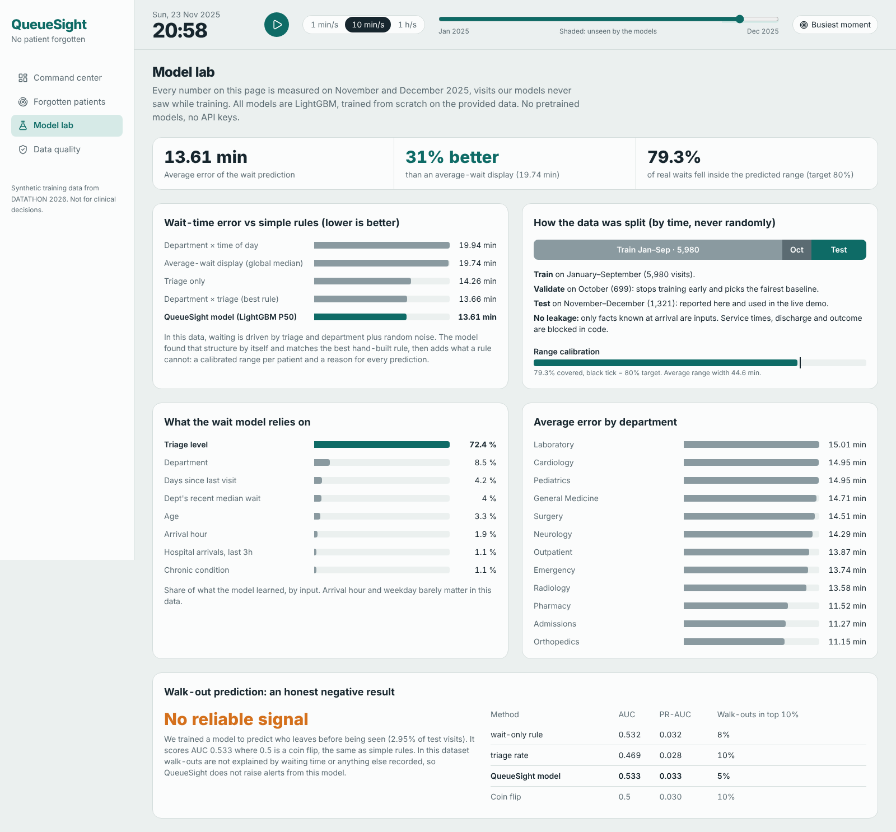
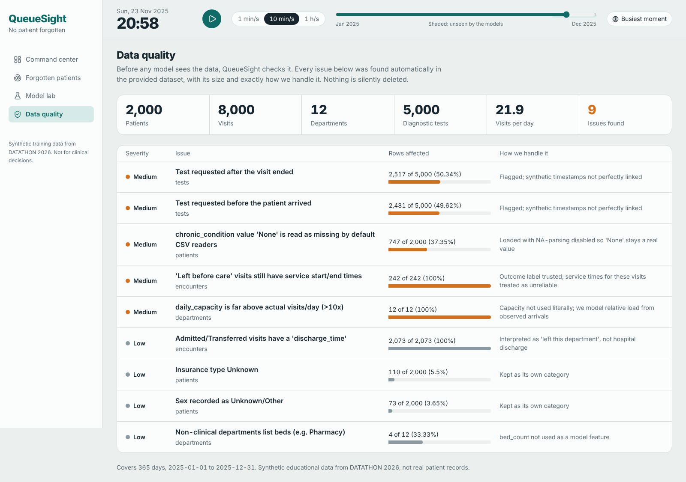
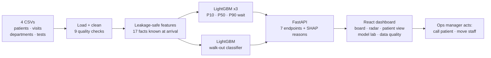

<div align="center">

# QueueSight

### No patient forgotten.

**Hospital-flow intelligence that gives every patient a personal predicted wait,<br>flags anyone who falls outside it, and explains why.**


**DATATHON 2026 · VIT-AP · Track 1 Health: The Forgotten Patient · Team Extremers**


</div>

---

## The problem

A hospital dashboard usually shows one number: *average wait*. Averages hide people.

A patient can sit far longer than someone like them normally would, and nobody notices until they walk out. In this dataset **3% of visits end with the patient leaving before care**, and on a bad day a department runs **25 minutes slower than its own normal**.

Operations managers need a direct answer to one question:

> **"Who is being forgotten right now, what is slowing them down, and where should we look first?"**

## What QueueSight does

| | Feature | What it means for the ops team |
|---|---|---|
| 🎯 | **Personal predicted wait range** | The moment a patient arrives, three models we trained predict a short, likely and long wait (P10 / P50 / P90) for *that* patient. |
| 🚨 | **Forgotten Patient Radar** | Anyone who has waited past their own P90, left without being seen, or is still waiting is ranked in one list. |
| 🏥 | **Department board** | Each department's wait today vs *its own* normal, with a 7-day trend, sorted by pressure, in the triage colours staff already know. |
| 💬 | **Plain-English explanations** | Every prediction shows its reasons, e.g. *"Triage level: High saves about 23 min."* Exact per-feature contributions come from the model itself (SHAP). |
| 🧪 | **Model lab** | Every model metric against every baseline, measured only on months the model never saw, including the results that didn't work. |
| 🛡️ | **Data quality center** | 9 issues found automatically in the raw data, each with its size and exactly how we handle it. |
| ⏯️ | **Live replay clock** | The 2025 data plays back like a live feed. The demo starts on **23 Nov 2025, a month the models never saw**. In production, this clock becomes a live hospital feed. |

<table>
<tr>
<td width="50%"><br><b>Forgotten Patient Radar.</b> Shaded band = predicted wait, tick = most likely, dot = actual wait so far.</td>
<td width="50%"><br><b>Why this prediction.</b> High triage saves 23 min and Pharmacy saves 4.5 min, so the most likely wait is 24 min.</td>
</tr>
<tr>
<td width="50%"><br><b>Model lab.</b> Baselines, time split, calibration, feature importance, honest negative result.</td>
<td width="50%"><br><b>Data quality center.</b> Every issue in the raw data and how it is handled.</td>
</tr>
<tr>
<td colspan="2"><br><b>A forgotten patient.</b> Predicted 16–66 min, actually waited 68. The dot has crossed the band, so the patient is flagged.</td>
</tr>
</table>

---

## How it works



**Input → output → action:** a patient arrives (triage, department, current queue). QueueSight predicts their personal range and the reasons behind it. If they wait past the range, they're flagged on the radar, and the manager checks the department board and acts.

---

## How we used the dataset: every table, every column

All four tables are joined: `patients (2,000) → encounters (8,000) → departments (12)` and `encounters → diagnostic_tests (5,000)`. That covers 365 days at about **22 visits/day**. Every column has a deliberate role; nothing is used blindly and nothing is ignored without a reason.

### `encounters.csv`: the core table
| Column | How QueueSight uses it |
|---|---|
| `encounter_id` | Primary key; joins tests to visits |
| `patient_id` | Joins to patients; builds **prior visits** and **days since last visit** from earlier visits only |
| `arrival_time` | **Time-based split**, hour / weekday / weekend features, the replay clock, and all live-load features |
| `department_id` | Model feature (2nd strongest), department board, department normal wait |
| `visit_type` | Model feature (measured: no effect on wait in this data) |
| `triage_level` | Model feature, **the strongest driver** (72% of learned importance) |
| `service_start_time` | Defines the target; live queue features use only *whether* an earlier patient had started by time *t*, never their future time |
| `service_end_time` | **Patients in care** at arrival; quality check (end before start) |
| `wait_minutes` | **Target**, verified against timestamps (0 mismatches) |
| `service_minutes` | Quality check only; **blocked as an input** (known only after the visit) |
| `discharge_time` | Days since the *previous* visit's discharge; quality checks |
| `outcome` | Label for the walk-out model; **blocked as an input** to the wait model |

### `patients.csv`
| Column | How QueueSight uses it |
|---|---|
| `patient_id` | Join key |
| `age`, `sex`, `insurance_type` | Model features ("Unknown" kept as its own category) |
| `chronic_condition` | Model feature. The value **"None"** is read as *missing* by default CSV readers (747 patients); we disable that so it stays a real value |
| `home_area` | Profiled in the signal check (0 importance); left out of the model to avoid noise from 20 levels |

### `departments.csv`
| Column | How QueueSight uses it |
|---|---|
| `department_id`, `department_name` | Join key and UI labels |
| `staff_count`, `bed_count`, `daily_capacity` | **Quality-checked, deliberately not features.** They are constant per department, so they add nothing beyond `department_id`, and capacity is 85–240× actual daily volume |
| `service_type` | Quality check: 4 non-clinical departments list beds |

### `diagnostic_tests.csv`
| Column | How QueueSight uses it |
|---|---|
| `test_id`, `encounter_id` | Joins tests to visits; shown per patient in the patient drawer |
| `test_type`, `priority` | Turnaround analysis by type × priority; turnaround model attempted (see *What didn't work*) |
| `requested_time`, `completion_time` | Turnaround minutes; timestamp alignment check (99.9% fall outside their own visit) |

### Feature engineering: 17 facts known *at the moment of arrival*
Triage, department, visit type, age, sex, chronic condition, insurance, hour, weekday, weekend, prior visits, days since last visit, **patients already waiting in that department**, patients in care, department arrivals in the last 24 h, hospital arrivals in the last 3 h, and the **department's median wait over the previous 30 days** (counting only patients who had already been seen at that moment).

**Leakage is blocked in code.** `app/features.py` holds a `FORBIDDEN` list (service times, discharge, outcome) and an `assert` that stops the program if any of them reaches the model.

### Insights from the data
- **Triage drives waiting.** Median wait: Critical **13 min**, High **26**, Medium **49**, Low **72**.
- **Departments add up to 17 min.** Pediatrics and Laboratory are slowest (median 62); Cardiology, Pharmacy and Admissions are fastest (45).
- **Time doesn't matter.** Arrival hour, weekday, month and visit type have no measurable effect on wait.
- **Urgent tests are no faster than Routine.** Both have a median turnaround of about 58 min. In a real hospital, that means the priority flag isn't being honoured.
- **Returns:** 7.6% of patients come back within 7 days; 3.0% leave before being seen.

### Data quality: 9 issues, each handled explicitly

| Issue | Rows affected | How we handled it |
|---|---|---|
| Test requested after the visit ended | 2,517 / 5,000 (50.3%) | Flagged; test timestamps are not linked to visits |
| Test requested before the patient arrived | 2,481 / 5,000 (49.6%) | Flagged; test timestamps are not linked to visits |
| `chronic_condition` value **"None"** silently read as *missing* | 747 / 2,000 (37.4%) | Loaded with NA-parsing disabled so "None" stays a real value |
| "Left before care" visits still have service start/end times | 242 / 242 (100%) | Outcome label trusted; service times treated as unreliable |
| `daily_capacity` is 85–240× actual visits/day | 12 / 12 (100%) | Capacity not used literally; load is modelled from observed arrivals |
| Admitted/Transferred visits have a `discharge_time` | 2,073 / 2,073 (100%) | Interpreted as "left this department" |
| Insurance type Unknown | 110 / 2,000 (5.5%) | Kept as its own category |
| Sex recorded as Unknown/Other | 73 / 2,000 (3.7%) | Kept as its own category |
| Non-clinical departments list beds (e.g. Pharmacy) | 4 / 12 | `bed_count` not used as a feature |

> Reproduce with `python -m scripts.profile_data`. Saved in `backend/artifacts/quality.json`; shown live in the Data quality page.

---

## Machine learning

### Models, all trained from scratch on the provided data

| # | Model | Predicts | Used for |
|---|---|---|---|
| 1 | LightGBM, quantile loss α=0.1 | **P10**: a short wait for this patient | Lower edge of the band |
| 2 | LightGBM, quantile loss α=0.5 | **P50**: the most likely wait | Tick on the band, "why" explanations |
| 3 | LightGBM, quantile loss α=0.9 | **P90**: a long wait for this patient | **The alarm line.** Waiting past it means forgotten |
| 4 | LightGBM, binary classifier | Chance of leaving before care, given minutes waited | Reported honestly, not used for alerts |

**Why three wait models instead of one?** One number can't say whether 30 minutes is normal or alarming for a given patient. A range can. Each model is trained with *quantile (pinball) loss*: the P90 model is penalised 9× more for guessing too low than too high, so it learns a value 90% of real waits stay under. The P10 model is the mirror image. The range width is learned per patient, not fixed:

| Triage | P10 | P50 | P90 | Width |
|---|---|---|---|---|
| Critical | 4 | 17 | 40 | 37 min |
| High | 9 | 29 | 50 | 41 min |
| Medium | 26 | 48 | 69 | 45 min |
| Low | 45 | 70 | 91 | 46 min |

### Evaluation: split by time, never randomly

| Split | Period | Visits | Role |
|---|---|---|---|
| Train | Jan–Sep 2025 | 5,980 | Fit the models |
| Validation | Oct 2025 | 699 | Early stopping; choose the fairest baseline |
| **Test** | **Nov–Dec 2025** | **1,321** | **Reported only; never used for training or tuning** |

### Results on the unseen test months

| Method | MAE (minutes) |
|---|---|
| Department × time-of-day median | 19.94 |
| Global median (an "average wait" display) | 19.74 |
| Triage median | 14.26 |
| Department × triage median (best hand-built rule) | 13.66 |
| **QueueSight (LightGBM P50)** | **13.61** |

- **31% more accurate than an average-wait display.**
- **Matches the best hand-built rule without being told it.** In this data, wait ≈ triage + department + noise. The model found that structure by itself (triage 72%, department 8.5% of learned importance), and the remaining ~13.6 min is noise no model can predict. We did not tune further against the test set to chase a smaller number.
- **Calibrated ranges:** the P10–P90 band contains **79.3%** of real waits against an 80% target (average width 44.6 min).
- **Error by department** ranges from 11.2 min (Orthopedics) to 15.0 min (Laboratory). Full breakdown in `metrics.json` and the Model lab page.

### Model card

| | Wait models (P10 / P50 / P90) | Walk-out classifier |
|---|---|---|
| Algorithm | LightGBM `LGBMRegressor`, `objective="quantile"` | LightGBM `LGBMClassifier`, `objective="binary"` |
| Key hyperparameters | `learning_rate=0.03`, `num_leaves=15`, `min_child_samples=30`, `subsample=0.8`, `colsample_bytree=0.8`, `reg_lambda=1.0` | `learning_rate=0.03`, `num_leaves=7`, `min_child_samples=40` |
| Trees | up to 3,000 with early stopping (150 rounds) on October → trained 100 / 140 / 146 | up to 2,000 with early stopping → trained 61 |
| Inputs | 17 arrival-time features (6 categorical, 11 numeric) | Same 17 + minutes waited so far |
| Categoricals | Fixed category lists saved with the model, so training and serving encode identically | Same |
| Explanations | Exact SHAP contributions via LightGBM `pred_contrib` | Same |
| Metrics | MAE, P10–P90 coverage, interval width, MAE by department | AUC, PR-AUC, recall in top 10%, Brier score |
| Reproducibility | `random_state=42`; `python -m scripts.train_models` retrains everything in about 1 s | Same |
| Saved to | `backend/artifacts/models/wait_model.joblib`, `metrics.json` | `backend/artifacts/models/lbc_model.joblib` |

### What we tried that didn't work, and what we did about it
| Attempt | Result on unseen months | Decision |
|---|---|---|
| Department × time-of-day rule | MAE 19.94, worse than a plain median | Proves time of day doesn't drive waits here; arrival hour kept as a feature but carries 1.9% importance |
| **Walk-out (left before care) classifier** | **AUC 0.533** (coin flip 0.5), PR-AUC 0.033 vs 2.95% base rate; simple rules the same (0.532, 0.469) | Walk-outs are not predictable from anything recorded, including wait time. **Reported, not used for alerts** |
| Diagnostic turnaround model (type, priority, department, triage, hour) | MAE 40.3 vs 38.3 for a type × priority median (`scripts/profile_data.py`) | No signal beyond type × priority. **Not deployed**; turnaround is reported as an operational finding (Urgent ≈ Routine) |
| Department staffing / capacity as features | Constant per department; capacity 85–240× real volume | Kept out of the model; logged as data-quality issues |

---

## Tech stack, and why

| Layer | Choice | Why |
|---|---|---|
| Data | Python, pandas, NumPy | Joins, cleaning, time-based features |
| Models | **LightGBM**, scikit-learn | The strongest method for tabular data; quantile loss gives ranges; trains in about 1 s |
| Explanations | SHAP (LightGBM `pred_contrib`) | Exact contributions, no extra service |
| API | **FastAPI** | Typed, fast, auto-generated docs at `/docs` |
| Frontend | **React 19, TypeScript, Vite** | Fast, typed, product-grade UI |
| UI | Tailwind CSS 4, TanStack Query, Framer Motion | Design tokens, cached live data, motion only where it explains a change |
| Design | Triage colours, Atkinson Hyperlegible font | Status colours staff already know; a typeface designed for legibility |

**No LLM, no API keys, no pretrained models.** The predictions come from models we trained. Patient data never leaves the machine.

---

## Run it locally

### Fastest: Docker (one command)

Needs only [Docker Desktop](https://www.docker.com/products/docker-desktop/), no Python or Node.

```powershell
git clone https://github.com/keshav301104/QueueSight.git
cd QueueSight
docker compose up --build
```

Open **http://localhost:8080**. API docs: http://localhost:8000/docs. The first build takes a few minutes; after that it starts in seconds. Stop with `Ctrl+C`, then `docker compose down`.


#### The simulated hospital

QueueSight also ships a simulated 12-department hospital (153,000 visits in 2025) where walk-outs have real causes. To run it, create a file called `.env` next to `compose.yaml` with this one line:

```
QUEUESIGHT_DATA=sim
```

Then run `docker compose up -d --build`. The first start simulates the year and trains the models (a few minutes); they are kept in Docker volumes, so every start after that skips this step and is ready in under a minute. Remove the line to switch back to the DATATHON hospital, and use `docker compose down -v` to delete the simulated hospital and start fresh.

### Without Docker

**Prerequisites:** Python 3.11+ and Node 20+.

### 1. Backend
```powershell
cd backend
python -m venv .venv
.venv\Scripts\Activate.ps1          # macOS/Linux: source .venv/bin/activate
pip install -r requirements.txt
python -m scripts.train_models      # trains all 4 models in ~1 s and prints results
python -m uvicorn app.main:app --reload --port 8000
```
Check that http://localhost:8000/api/health returns `{"status":"ok"}`. Interactive API docs are at http://localhost:8000/docs.

### 2. Frontend (second terminal)
```powershell
cd frontend
npm install
npm run dev
```
Open **http://localhost:5173**. Press ▶ to replay, and click any patient to see why.

### Optional: data health report
```powershell
cd backend
python -m scripts.profile_data
```

---

## API

| Endpoint | Returns |
|---|---|
| `GET /api/health` | Service status |
| `GET /api/meta` | Time range, test period start, departments, demo start time |
| `GET /api/snapshot?t=` | KPIs and the department board at time `t` |
| `GET /api/radar?t=&hours=` | Forgotten patients in a look-back window |
| `GET /api/encounters/{id}?t=` | One patient: predicted range, reasons, risk curve, tests, history |
| `GET /api/metrics` | All model metrics vs baselines |
| `GET /api/quality` | Data-quality report |

---

## Project structure

```
QueueSight/
├── data/raw/                     # DATATHON 2026 Track 1 dataset (synthetic)
├── backend/
│   ├── app/
│   │   ├── config.py             # paths + time split
│   │   ├── data.py               # safe CSV loading + cleaning
│   │   ├── quality.py            # data-quality checks
│   │   ├── features.py           # leakage-safe features + guard
│   │   ├── ml.py                 # models, baselines, evaluation
│   │   ├── explain.py            # SHAP → plain English
│   │   ├── state.py              # loads data + models at startup
│   │   ├── snapshot.py           # board, radar, patient detail at time t
│   │   └── main.py               # FastAPI app
│   ├── scripts/
│   │   ├── profile_data.py       # data health + signal check
│   │   └── train_models.py       # one-command training pipeline
│   └── artifacts/                # trained models, metrics.json, quality.json
├── frontend/src/
│   ├── lib/                      # typed API client, replay clock
│   ├── components/               # WaitBand, Sparkline, RiskCurve, PatientDrawer
│   └── pages/                    # CommandCenter, Radar, ModelLab, DataQuality
└── docs/screenshots/
```

---

## Mapping to the judging rubric

| Criterion | Where to look |
|---|---|
| Problem understanding & user need | [The problem](#the-problem). User: hospital ops managers; workflow: "who is being forgotten" |
| Provided dataset usage | [Every table, every column](#how-we-used-the-dataset-every-table-every-column); 9 quality issues; 5 insights |
| Data science / ML quality | 4 baselines, time split, MAE + calibration, model card, [what didn't work](#what-we-tried-that-didnt-work-and-what-we-did-about-it) |
| ML model from scratch | 4 LightGBM models trained on the provided data; no API keys or pretrained models |
| Working product & workflow | FastAPI + React, live replay, input → prediction → reason → action |
| USP & innovation | Personal predicted *range*, explained flags, replay on unseen months, Model lab |
| Impact & responsible use | [Limitations](#responsible-use-and-limitations) below |

---

## Responsible use and limitations

- **Synthetic data.** Results show the method works; they do not prove real-world performance.
- **Low volume:** about 22 visits/day across 12 departments, so per-department signals are thin.
- **Test timestamps are not linked to visits** in this dataset, so per-visit test timing can't be trusted.
- **Walk-outs are not predictable** here (AUC 0.53), so that model is not used for alerts.
- **Decision support only.** QueueSight never replaces clinical triage, takes no automatic actions, and uses no real patient data.

## Roadmap
- Diagnostics monitor with "Urgent not honoured" alerts
- What-if staffing simulator
- Live HL7/FHIR feed instead of the replay clock; retraining and drift monitoring on real hospital data
- Optional on-premise AI shift briefing that only narrates QueueSight's own numbers

## Disclosures
- **Dataset:** DATATHON 2026 Track 1 synthetic dataset from the organisers (Data Science Club × IIEC, VIT-AP). No external data.
- **Models:** all trained by the team from scratch. No pretrained models, no hosted APIs, no API keys.
- **Libraries:** open-source only (pandas, NumPy, scikit-learn, LightGBM, FastAPI, React, Vite, Tailwind, TanStack Query, Framer Motion, lucide-react).
- **Tools:**  an AI coding assistant was used during development. All code was reviewed, run and tested by the team.

## References
- Ke et al., *LightGBM: A Highly Efficient Gradient Boosting Decision Tree*, NeurIPS 2017
- Lundberg & Lee, *A Unified Approach to Interpreting Model Predictions* (SHAP), NeurIPS 2017
- Koenker & Bassett, *Regression Quantiles*, Econometrica 1978

## Team Extremers
- Keshav Sharma
- Tanishka

<div align="center"><sub>Synthetic educational data. Not for clinical decisions.</sub></div>